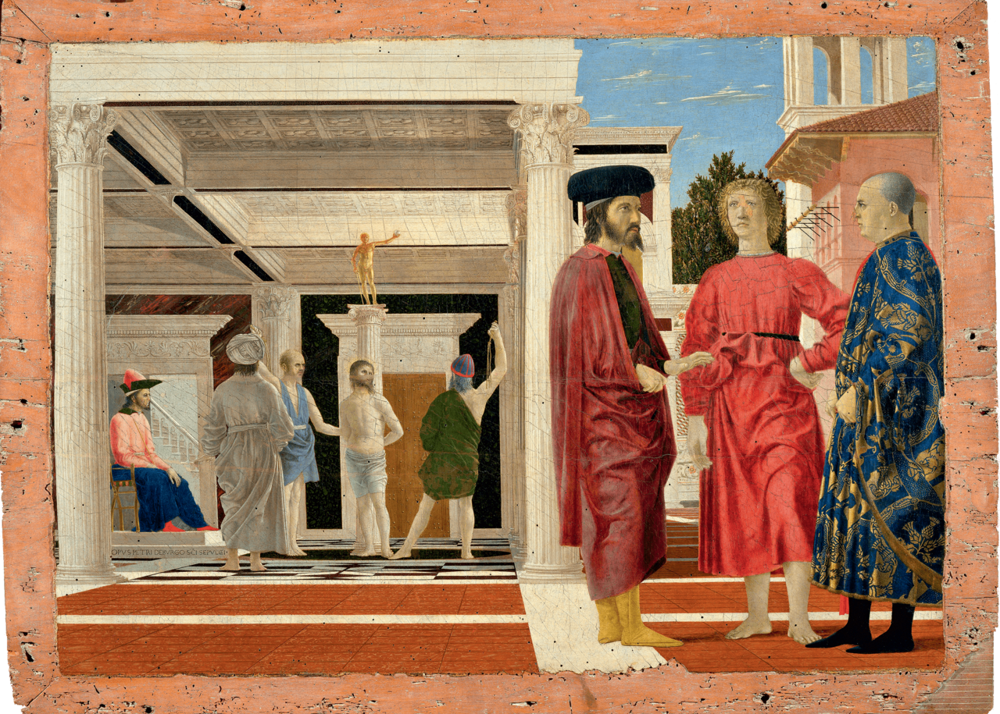

<figure>
  
  <figcaption>
    <a href="https://www.arthistoryproject.com/artists/piero-della-francesca/flagellation-of-christ/">Flagelación de Cristo</a> by <a href="https://en.wikipedia.org/wiki/Piero_della_Francesca">Piero della Francesca</a>.
  </figcaption>
</figure>

Caught up in a geometric web of lines  
Framed by a harmonic architecture  
Frozen in a perspective without prospect  
The director assigned the roles and went to buy cigarettes  
He will never return  
He does not even smoke  
Who cares? I don't need stuntmen for this  
I am better than Tom Cruise  
Keeping still in front of the whip  
is the most difficult scene of my career  
I will get a nomination to the Oscars  
Or will it be to the ERCs?  
And the ERC for the best supporting PI goes to…?  
We don't know yet  
The golden statue is there watching us  
but they are still deliberating  
Eyes towards the sky counting citations  
Finely dressed and bibliometrically obsessed  
Wearing hats and gowns  
while pondering our ups and downs  
They don't see the blue sky and nor do I  
The clouds so irregularly shaped  
and the trees so stubbornly chased  
by our imagination  
Silent sentinels  
Witnesses to our wit  
and to our geometric web of li(v)es.
