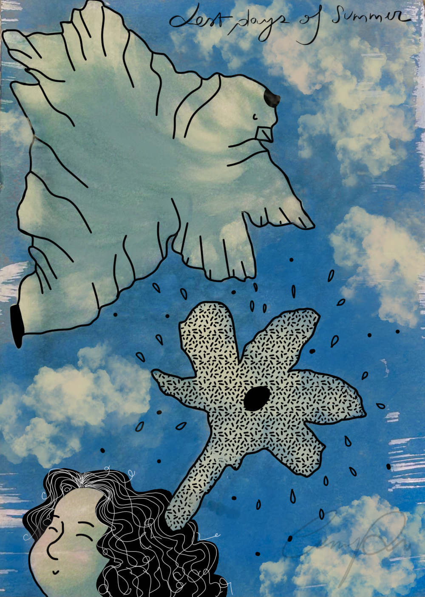

_Last Days of Summer_ captures a sense of what ease looks like and
how quickly it can disappear. It is no coincidence that this artwork was
created using the cyanotype technique: by applying light-sensitive
solutions on paper and placing objects on top of it, you can print their
“shadows”. 

It is like a photograph of that specific moment, which can change depending on
the angle of the light. In a certain sense, this makes the technique so
fascinating because it can capture something that no longer exists. 

Unfortunately, this was my first attempt at cyanotype, and it turned out a bit
blurry and not so satisfying. However, my melancholic soul saw potential in
this print, and I decided to complete it with digital art. 

I wanted to convey that bittersweet sensation you feel when you are in a
state of pure joy, and you know it’s going to end sooner or later (or am I the
only one?). Like when summer is ending, the long days of sunlight are going to
end, and you try to make the most of every moment to create memories because
you know that they will not be there again. 

As someone wise once said, “Carpe diem.” My “Carpe diem” is the last days of
summer, when I can say, “Hey, I want to enjoy everything around me: the birds
flying freely and singing until sunset, the different colours of flowers, and
the feeling of the wind in my hair after swimming in the sea.” 

