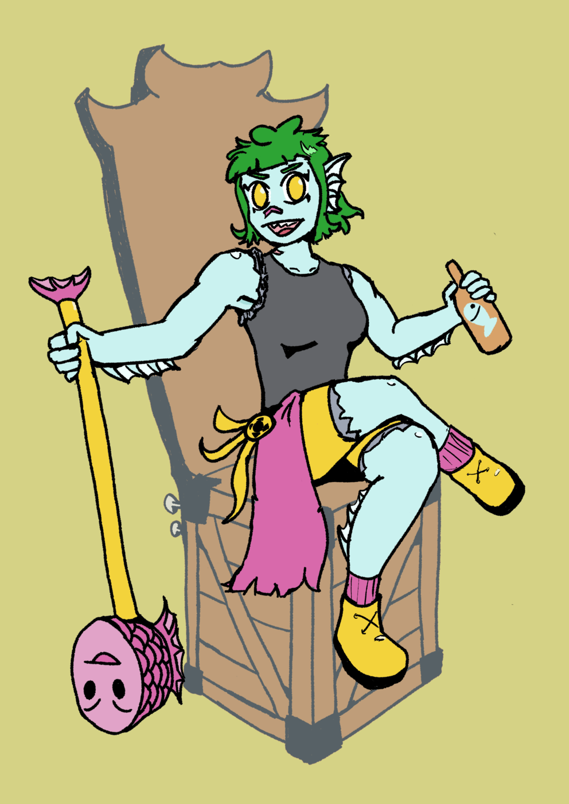

<figure>
  
  <figcaption>Enryn, the Triton Barbarian by {{ page.author }}</figcaption>
</figure>

Hello SISSA Inkwell readers! I am Rubio, and I like to draw. I try to practice
regularly and finish one artwork every month (check out
[@mugmugcomics](https://www.instagram.com/mugmugcomics) on Instagram). I am
also the _de facto_ president of Drawing Club, and we do sessions regularly in
SISSA, ICTP and downtown. I find drawing together is much more fun than drawing
alone. Today, I would like to share the history of how I got into drawing, and
my personal muse. 

I grew up with a lot of internet influence; the screen is my second home. A
huge part of my identity has been shaped by online pop culture geek/nerd
spaces. You can see most of my art is based on comics, animation, and games.
Two things I enjoyed are tabletop RPGs (such as Dungeons & Dragons), and
virtual youtubers (look them up, it’s an anime thing). 

Back in September 2022 when I first came to Trieste, I was routinely following
some Indonesian virtual youtubers from a company called Nijisanji Indonesia.
The company’s Indonesian branch doesn’t exist anymore, and most of the people I
were following have moved on to other forms of content or retired from content
creation entirely. I miss those times. I fondly remember how their existence
helped soothe my homesickness. 

At the time, they were also doing a short Dungeons & Dragons series. One of
them played a character named Enryn, a Triton Barbarian, basically a mermaid
warrior girl with legs who hits things with a big hammer. Her existence changed
my life forever. I really liked fish/ocean-themed aesthetics in characters. But
what made her really stand out is the fact that she’s strong, silly, funny, and
sweet. Kinda like a himbo but a girl, if that makes sense? I love her so much,
so I just had to start drawing her. I even have a whole Google Drive folder
dedicated for her with dozens of artworks by me and friends. 

I’ve been drawing for 4 years, and over 50% of my art is Enryn-posting. I have
improved a lot just because of how obsessed I am with this teal fish woman. My
friends know me as the “Fish Wife Guy”. In fact, in September 2024 me and a
group of Indonesian friends self-published an illustrated science comic book
about various fish species from Indonesia. (We also did some illustrated pop
math books, and I hope to share those another day.) 

Anyway, having a muse has been great for my art. I want to draw her forever!
Find your muse guys, it’s a great investment if you want to make art. You can
find your muse anywhere, in nature, in life, and in your own imagination. And
when you do, come to the Drawing Club!

