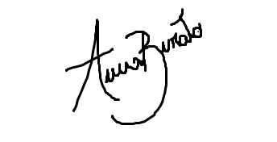

Non scrivete sui muri  
L’avevo imparato  
Dentro una scatola  
Ogni pensiero colorato

Non fate i duri  
Non avevo ascoltato  
Dentro un respiro  
Ogni dolore soffocato

È ora che ti curi  
L’avevo accettato  
Dentro una stanza  
Ogni minuto contato  

Ora scrivo sui muri  
L’ho disimparato  
In questa città  
Il mio pensiero liberato

