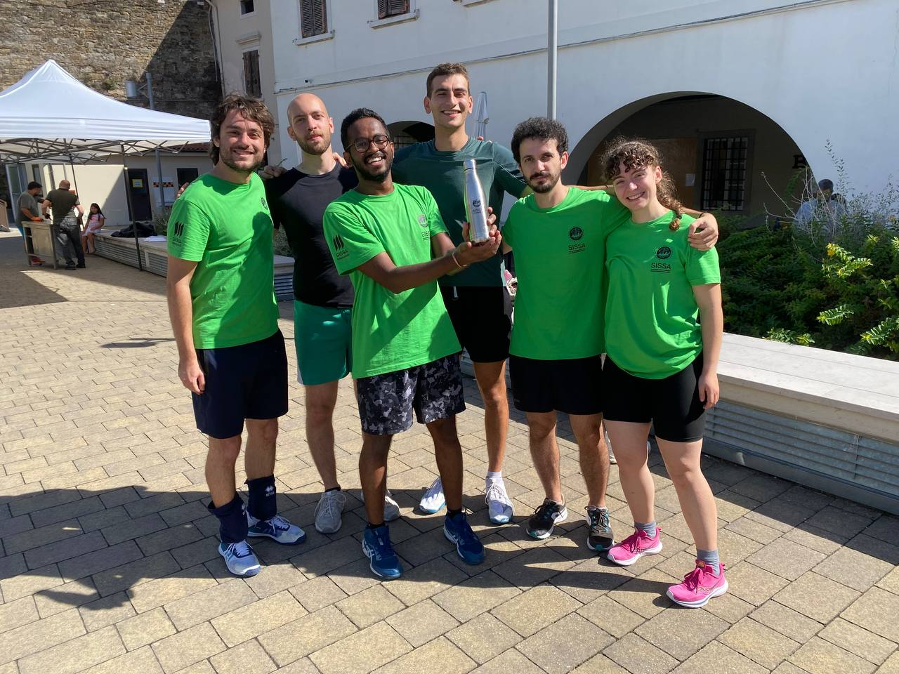
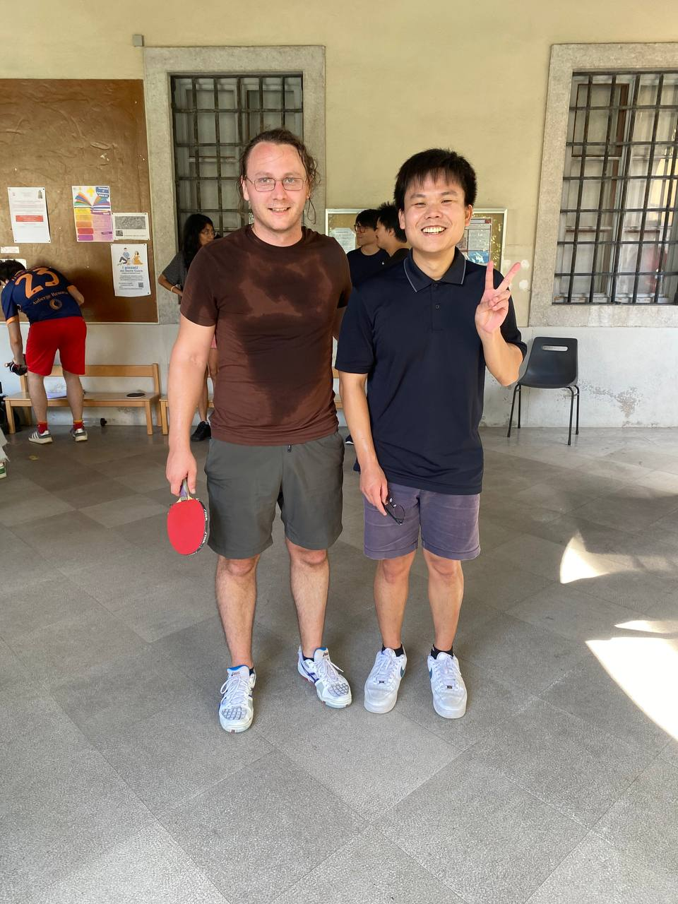
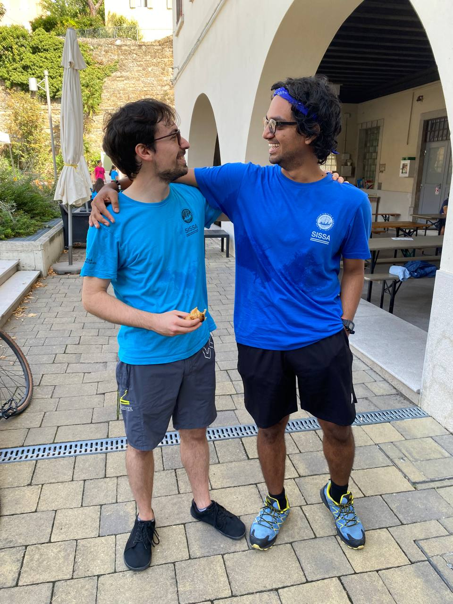

## Basketball

This year, only a few players took part in the basketball tournament, but the
two teams proved fiercely competitive in what was essentially a derby between
mathematicians. The match was played as a best-of-three series, with each game
going to 21 points. In the end, the team led by the veteran Nicolò Tonicello,
alongside Sergio Scalabrino and Maxim Zewe, came out on top with a convincing
2–0 victory.

__Winners.__ Math 2 (Tonicello, Scalabrino, Zewe)

## Football

The football tournament saw teams from Physics, MathLab, and Data Science
compete in a three-way contest. The latter this year also featured a delegation
of “athletes” from the University of Trieste.

The tournament kicked off with the physicists defeating the data scientists.
Later that afternoon, MathLab swept away the Physics team with a 12--6 victory
and in the final match overcome Data Science on penalties. An undisputed
tournament victory for MathLab's “yellow shirts”!

__Winners.__ MathLab (Tonicello, Pichi, Li Causi, Bili, Della Pia, Demo,
Cecchi)

## Volleyball

The volleyball tournament was fiercely contested. The mathematicians deployed
two teams but, hampered by several unexpected absences, struggled to win many
matches. The most competitive teams were Data Science and Physics.

The former was a mixture of “genio e sregolatezza” (brilliance and
unpredictability), with frequent substitutions and plenty of ups and downs.
Under the leadership of Alessio Giorlandino and Matteo Allione, they managed to
secure second place. In the end, however, Physics emerged victorious and proved
to be the most consistent and united team.

__Winners.__ Physics (Sacco, Romano, Russotto, Keppler, Tortora, Panduranghan Udhayashankar)

<figure>
  
</figure>

## Table tennis (doubles)

After four years of trying, data scientists Federico Caretti and Debarshi
Banerjee finally claimed victory in the table tennis double tournament. The
trophy was awarded during their PhD graduation celebration.

__Winners.__ Federico “Fedo” Caretti and Debarshi Banerjee.

  <figure>
    
    <figcaption>
      Table tennis (singles) finalists Ting-Yang Hsiao and Timon Kunze.
    </figcaption>
  </figure>
  
  <figure>
    
    <figcaption>
      Table tennis (doubles) winners Federico Caretti and Debarshi Banerjee.
    </figcaption>
  </figure>

## Table tennis (singles)

If there is one sport that truly defines SISSA, it is undoubtedly table tennis.
This year's tournament featured an initial group stage with five groups,
followed by knockout rounds starting from the quarter-finals.

The final was a clash between defending champion Timon Kunze and new challenger
Ting-Yang Hsiao. During the SISSA Games finals, the entire crowd gathered
around the table tennis court to witness a thrilling match, marked by
uncatchable trick shots and extraordinary concentration from both players.

Winning three sets to one, Timon successfully defended his title and was
crowned SISSA table tennis champion once again.

__Winner.__ Timon Kunze

## Honourable mention

The ultimate all-round athlete of this year's edition was undoubtedly the
tireless __Gaspare Li Causi__, who played one basketball match, two football
matches, and three volleyball matches on Saturday alone, and somehow was still
standing by the end of the day. If your team ever needs an extra player, you
know who to call!

## Acknowledgements

Many thanks to Gregorio Staffieri for helping me organize the table tennis
tournaments and for overseeing their smooth running.

