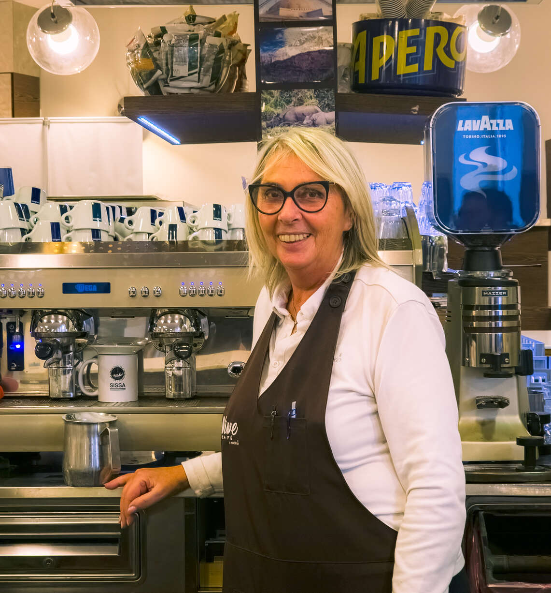

<figure>
  
  <figcaption>Patrizia at the SISSA bar, next to the coffee station. Portrait
  by Nour El-Kazwini.
  </figcaption>
</figure>

For almost seventeen years, Patrizia has been the first face many of us see in
the morning: the one who knows your name and your order before you reach the
counter. 
Before she retires next year, we sat down with her to talk about
coffee, a childhood in South Africa, twenty-two years running a bar in Muggia,
and what it's really like to serve a building full of scientists. 

## First things first: the coffee 

__How do you take your coffee?__

An espresso with just a little cold milk. No sugar. 

__And how many a day?__

Two at home before I leave, then one at the bar in
Opicina on my way here. So three, all before I even start work. I wake up at
5:45, so I need them! 

## A childhood in South Africa 

__You grew up in South Africa. How did that happen?__

I was born in 1963, and in 1966, when I was three, we moved there by ship. My
father had been a bartender on the ships sailing from Trieste to Australia,
Africa and America, but that was before I was born. In South Africa he opened a
ladies' bar, which was something new at the time. 

__Why was a ladies' bar new?__ 

In the sixties and seventies women weren't allowed in bars there. A ladies' bar
couldn't be on the street; it had to be inside a hotel, and only for women
staying there as guests. Before that, they simply had to stay in their rooms. 

It was the same with children. We weren't allowed to eat in the hotel
restaurant with our parents. We had dinner earlier, in a separate room with
other children and nannies, and then the parents went to dinner on their own. 

__What do you remember most from those years?__

Life was very good for white people in South Africa back then. There were
Italian clubs where all the Italian families met every weekend, with lots of
children. And I was very good at school, so good that the teacher called my
parents in to ask how an Italian girl could be doing so well! When we came back
to Italy, things changed. I still ask myself how that happened. 

I have funny memories too. We travelled around the country and lived in hotels,
and while our parents were out at dinner, the three of us kids would make a
huge mess of the room and keep calling room service. 

## Back in Trieste: school and searching 

__How was your relationship with maths and physics?__

Not bad at maths, and not bad at physics either! But I didn't like going to
school. My favourite subject was geography. 

__Did you imagine becoming a barista?__

Never. I changed schools a lot. I tried a year of nursing school, but I
couldn't stand the sight of blood. Then I went to a technical school for
surveyors, then bookkeeping. If I added all my studies together, I'd probably
have a degree by now! But I didn't finish any of them, because my father opened
a bar in Muggia and I started running it with him and my sister. 

## Twenty-two years in Muggia 

__What was it like running the family bar?__

It was a family business, all of us together. Sadly, we lost my father only a
few years after we opened, so he never got to enjoy what he had built. 

That's when I got into cocktails. I studied mixology, joined the International
Bartenders Association and started travelling to competitions in Scotland,
England, Spain, France. The year the international competition was in Aberdeen,
I won a silver medal. 

__What did all those years behind a counter teach you about people?__

I've often thought I could write a book about my customers! You meet every kind
of person, and so many strange requests. The good moments are when people
appreciate what you do. A simple "thank you" means more to me than a tip. 

The hard part of a normal bar is the drunk customers and the rude ones. In the
end, that's what I couldn't take anymore. 

__Why did you leave?__

We closed in 2007. My daughter was eleven, and I was always working: Fridays,
weekends, evenings, Christmas, Easter. I was watching her grow up from behind
the counter, so I decided to change my life and find a Monday-to-Friday job. My
younger sister, who ran the bar with me, wanted a change too, so we sold it
together. 

I tried an office job, but after six months I had to leave. I need human
contact. I can't spend the day talking to a laptop. 

## Arriving at SISSA 

__How did you end up here?__

Through my sister, who works at a hotel in Trieste. When SISSA moved to Via
Bonomea in 2010 and brought everything under one roof, the company hired to run
the canteen and bar was the same one running food and beverage at her hotel. I
met the director, she offered me the job, and I accepted. It's the best thing I
ever did. Weekends and holidays free! 

### Serving scientists 

__Is serving scientists different from serving customers in Muggia?__

Scientists are very repetitive, always the same order! And they have very busy
brains. They're always talking about science, physics, maths. Years ago a
professor asked me why we couldn't put a blackboard in the bar, so he and his
students could keep working over coffee. I told him the bar has to be a place
to relax. If they want to do science, they can go back to their offices. We'll
never put a blackboard in the bar! 

__Do people here confide in you, too?__

Less than in a normal bar. But it happens in other ways. Students come and ask
me, "Who's that pretty girl?" or "Who's that handsome boy? What does he study,
where's his office, is he single?" 

__How do you remember everyone's name and order?__

Everyone asks me that, and I honestly don't know! At school I wished I had a
good memory, and I didn't. It only started here at SISSA. It just comes
automatically. I'm not a mentalist! 

__You've seen generations pass through.__

Yes. PhD students finish, leave for their postdocs, and come back with
husbands, wives and children, and some of them are professors here now. When I
started I was in my forties and the students were about thirty, so the gap
wasn't so big. Now I'm 63 and they're still thirty, and the gap grows every
year. But I talk with everyone: young, old, everyone. I'm very empathetic, and
I love to chat. 

## Life outside the bar 

__What does life look like outside SISSA?__

I have a husband, a daughter, and in January I'll become a grandmother to a
little girl. I have a dog I adore. I love the gym and cycling; I ride through
Opicina every morning on my way here. I love going out with good friends for an
aperitivo, where I eat all the chips they put on the table. 

I read a lot too, mostly romance and crime novels. I only read each book once,
except Sidney Sheldon. He's my favourite. 

And I love the sea and the sun. That's why I like Trieste: the mountains and
the sea are both close, so we have everything we need. Though I don't go to the
mountains much. I suffer the cold too much! 

## Retirement, and a word for SISSA 

__What are you looking forward to?__

Travelling, and my granddaughter. I've travelled quite a lot, but never to the
Far East. I have two dreams: Japan, and going back to South Africa. Maybe now
I'll finally make them come true. 

__How would you describe that community?__

It's empathetic. When they accept you, it's like being welcomed into a family.
I felt it most during COVID, when the canteen and bar closed and we were at
home without a salary. The SISSA community organised a fundraiser for us. 

__Any last words for the SISSA community?__

After nearly seventeen years, I'll really miss this place and the people, the
SISSA community. 

Good luck, a lot of happiness, and all the best to all of them. From the very
first day I arrived, I've felt accepted, loved and appreciated. I feel it every
day I'm here. And it's the same for me: I treat everyone here as part of my
family.

---

Thank you, Patrizia, for the conversation, and for every coffee. 

