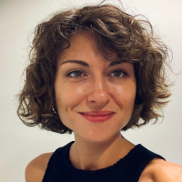
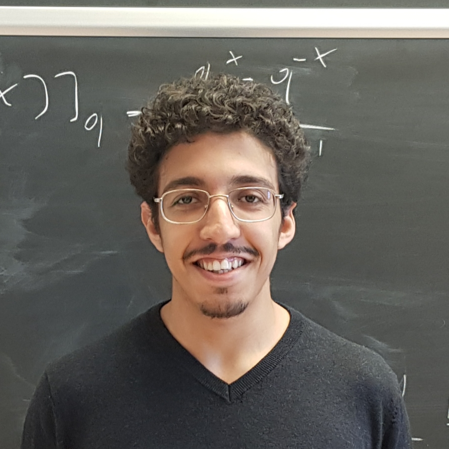
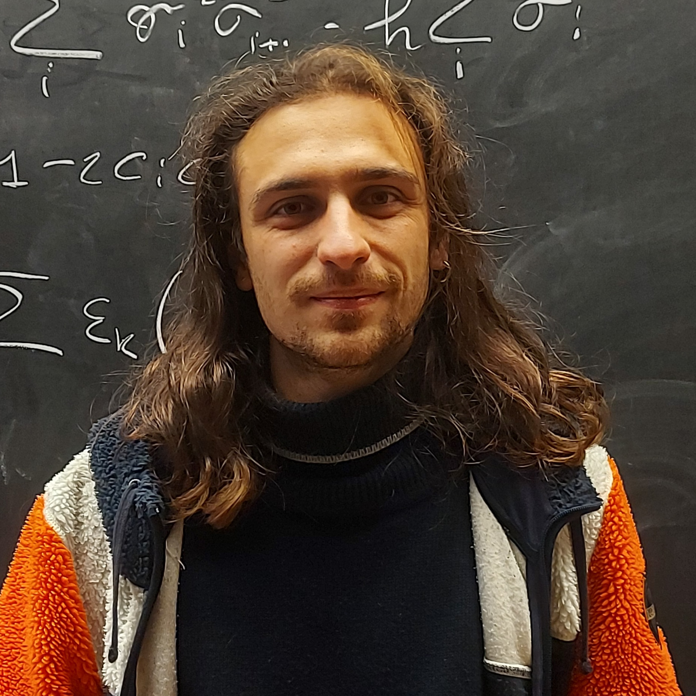
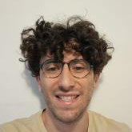
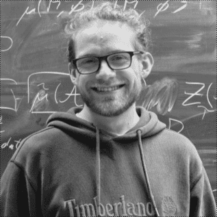

## Meet your new representatives

  <figure>
    
    <figcaption>Chiara Di Domenico  Academic Senate</figcaption>
  </figure>
  
  <figure>
    
    <figcaption> Youssef Makoudi  Academic Senate</figcaption>
  </figure>
  
  <figure>
    
    <figcaption>Matteo Rossi   Evaluation Unit</figcaption>
  </figure>

  <figure style="max-width: 265px">
    
    <figcaption>Gabriele Nani   Board of Directors</figcaption>
  </figure>
  
  <figure style="max-width: 265px">
    
    <figcaption>Samuele Di Valeriano   Board of Directors</figcaption>
  </figure>

## Choosing SISSA’s next Director

SISSA is selecting its next Director, who is expected to succeed Professor
Andrea Romanino on 1 November 2027 for a single, non-renewable six-year term.
Eight candidates have been shortlisted; three will advance to a second round of
visits.

The candidates are: Camillo Padoa-Schioppa, Paolo Cascini, Sandra Di Rocco,
Sandro Scandolo, Antonio Riotto, Andrea Cavalli, Leticia Cugliandolo and
Gianfranco Bertone.

Students take part in the election through their representatives on the School
Council, including those on the Academic Senate, Board of Directors and
Evaluation Unit, and the six directly elected Council representatives. We
encourage everyone to attend the seminar given by the candidates.

## 150h collaboration salary

The 150hours collaboration pay will be raised from 10.30 euros per hour to
11.30 euros per hour.

## Contribution towards the expenses for training and research

From January 2027 we will enter in the new regime where each student will have
every year 10% of his scholarship for missions, research expenses (Licences,
training, laptop, iPad…). Detailed contributions about this will be sent soon.
The news is that for the students currently in the fourth year (and only for
them), the 1000 euros that was part of the old regime meant to be a
contribution towards the expenses for training and research will be maintained
and students will be able to use that money on top of the 10% that they will
receive.

## AI task force

SISSA is moving its first steps to deal with disruptiveness of AI. A task force
composed by professors and students will discuss what is the role of SISSA as
AI contributes more to scientific knowledge, how to evaluate students
throughout their Ph.D experience and not just by the final thesis and formulate
proposals on how to change doctoral training, propose some thoughts and
reflections on publishing, including journals and archives, identify principles
for a responsible AI use and finally understand the institutional implications
of adopting these tools, including fair access to tools and training.

Students from the student council volunteered to take part of this task force.
Meanwhile, given the strong interest of the students, a small working group of
more students will work on parallel and continue also after the end of the
“official” task force. The goal of this small group is to follow decisions at
other universities and developments at AI companies, develop student proposals
and principles for AI in research and education, share their findings with the
student community though occasional discussions and events.

