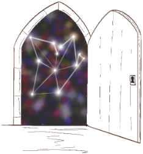

<figure class="float">
  
</figure>

Dear Reader,

Have you ever wondered how much you really know about the people around you, or
about the worlds beyond your own? Every day, we meet so many people here at
SISSA, from different countries and continents. We talk to them, laugh with
them, grab lunches together, work alongside them on a research project &
perhaps even consider them friends. Yet how much do we know about what goes on
inside their minds? Their worries, their dreams, their views of the world, the
things they hope for? Everyone seems to carry an entire world within
themselves, one that we rarely get to see. Perhaps someone you think you know
has a story you have never heard. There is, after all, so much more to people
than what meets the eye. 

This is part of what makes literature so special. It allows us to step into
these otherwise inaccessible worlds, to see things through someone else's eyes,
even if only for a little while. It reminds us that a person, a story, or an
experience always has more than we might initially think. 

I hope this edition of SISSA Inkwell does just that. I hope it makes you
curious, makes you think, and perhaps even makes you see something familiar in
a slightly different light. After all, we spend our lives walking past one
another, each carrying a world of our own. How wonderful it would be to
occasionally open the door to someone else's. 

Happy reading,  
Aliza Mustafa 

